# 实践课1 Pi Agent 安装与基础使用实验报告

实验日期：2026年11月9日  
GitHub 账号：Mr-ship  
姓名拼音：待补充，不以账号名代替真实姓名。  
实验环境：Windows、Node.js v24.18.0、npm 11.16.0、Pi 1.5.0。

本次完成 Pi 安装、DeepSeek 模型会话、模型与思考级别切换、代码引用、图片粘贴与识别、插件安装和实际调用，以及选做 PPT Skill 的安装、启动发现和调用。未选做生成两页 PPT。

## 一 安装并启动 Pi

安装命令来自 [Pi 官方仓库](https://github.com/earendil-works/pi)：

```powershell
npm install -g --ignore-scripts @earendil-works/pi-coding-agent
pi --version
cd pi-test
pi
```

版本检查得到 `1.5.0`。启动截图包含版本、当前工作目录和底部模型状态，证明客户端已运行。初次启动自动下载辅助搜索工具 fd 超时，后从 sharkdp/fd 官方 release 下载 v10.5.2 补齐，后续启动不再出现该警告。

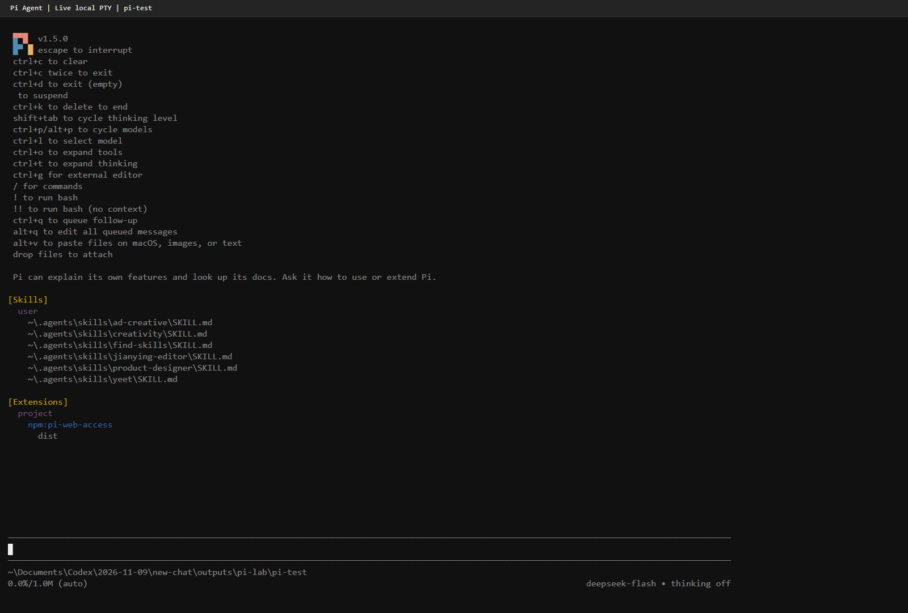

## 二 配置模型并完成会话

平台：[DeepSeek API Platform](https://platform.deepseek.com/api_keys)。接口地址为 `https://api.deepseek.com`。密钥仅保存在实验专用的本机私有配置中，不在本仓库、截图、报告或提交记录中。

对官方 `/models` 的认证请求成功，返回 `deepseek-flash` 与 `deepseek-v4-pro`。Pi 的 `auth check --provider deepseek --json` 返回 `ready`。

选用 `deepseek-flash`，思考级别为 `off`。发送“你好。请用中文简短回复，并说明你可以协助哪些编程任务。”，模型正常返回中文说明。截图保留发出的提示词、实际回复、工作目录和模型状态。


## 三 切换模型和思考级别

在同一会话执行：

```text
/model deepseek-v4-pro
/thinking high
请用一句话解释持续集成。
```

| 状态 | 模型 | 思考级别 | 验证 |
| --- | --- | --- | --- |
| 切换前 | deepseek-flash | off | 中文问候正常回复 |
| 切换后 | deepseek-v4-pro | high | 正常解释持续集成 |

模型解释：持续集成是一种频繁合并代码到共享主干，并自动构建和测试以尽早发现集成问题的开发实践。

简单问候、代码说明等任务可优先使用较轻的模型或关闭思考；复杂分析可以选择更强模型并提高思考级别。较高思考级别可能增加等待时间和用量，并不保证每次答案更好。模型切换与思考级别切换是两个不同操作。

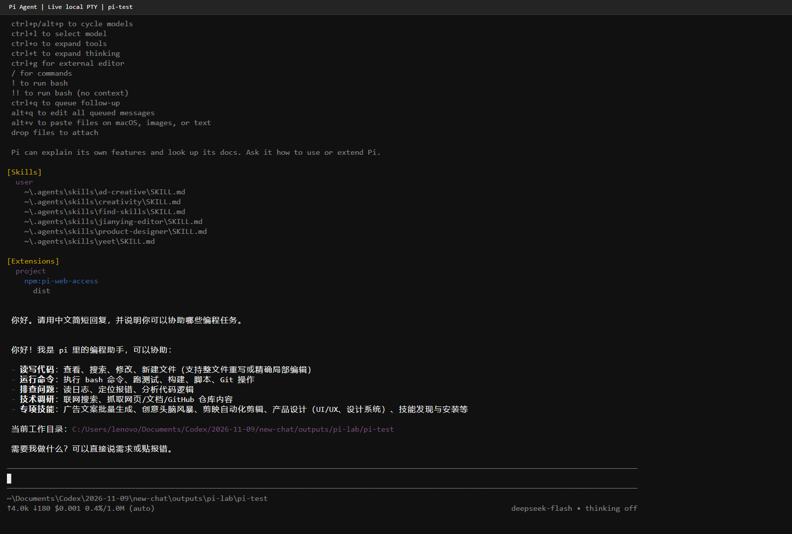

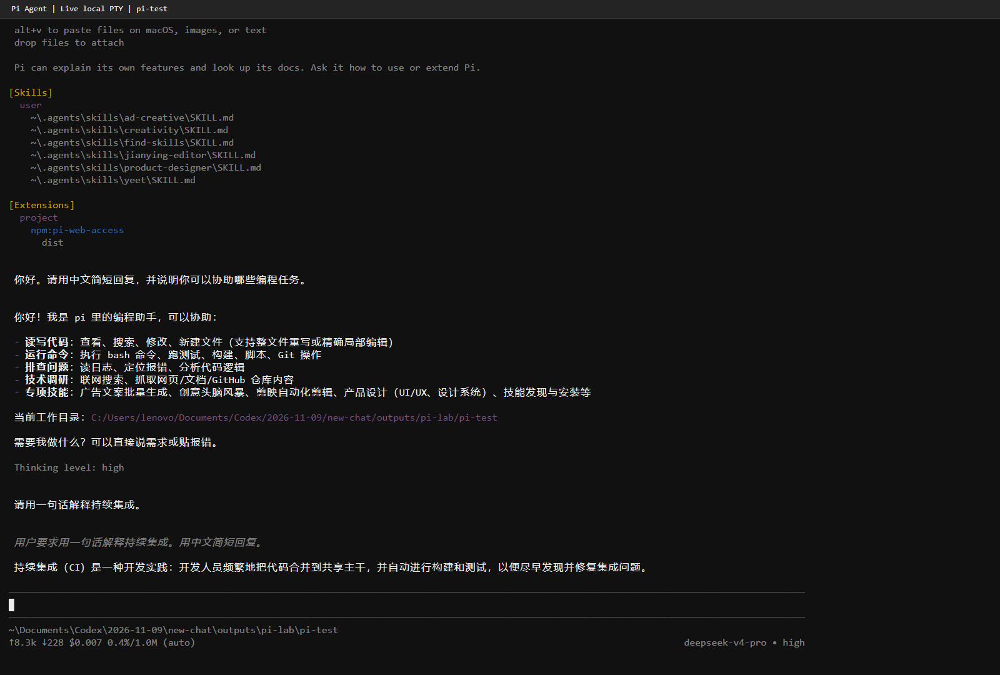

## 四 引用代码与图片测试

### 引用 hello.py

创建并保持以下文件不变：

```python
def add(a, b):
    return a + b


print(add(2, 3))
```

在 Pi 输入 `@hello.py`，候选列表出现后通过 Tab 选中，再输入“请解释引用的 hello.py 的功能，说明运行后输出什么。只解释，不修改文件。”

Pi 实际调用 `read hello.py`，解释 `add` 返回两个参数之和，指出 `print(add(2, 3))` 的输出为 `5`。本地复核文件未修改，运行输出也为 `5`。

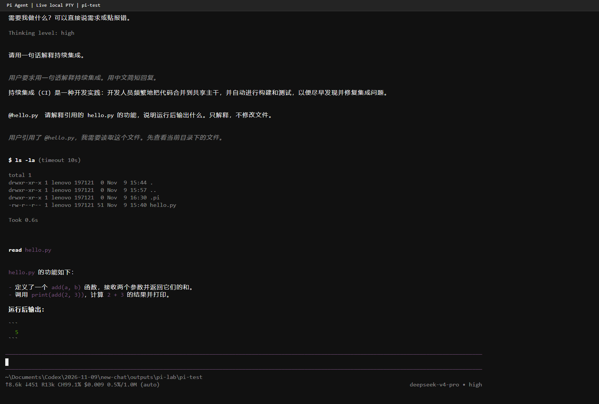

### 剪贴板图片粘贴和识别

原始测试图片为 200×200 PNG，内容是白色背景、蓝色正方形和黑色数字 7：


将图像内容而非文件路径放入 Windows 图像剪贴板，确认 `Clipboard.ContainsImage()` 为真，在 Pi 使用 Windows `Alt+V` 粘贴。Pi 1.5.0 在本终端把剪贴板图像保存成 `pi-clipboard-….png` 临时路径并插入输入区。该路径是 Pi 根据真实剪贴板图像生成，不是手工粘贴的文件路径。

读取生成的临时图片并人工核对，确认与原图内容相同。显式使用 `deepseek-flash` 新进程，发送“请描述图片中的颜色、形状和数字，简短回答。”。Pi 调用图片读取工具后，实际回复白色背景、蓝色实心正方形、黑色数字 7，与原图一致。

排查中发现新会话可能恢复默认的 `deepseek-v4-pro`，该模型不支持图片输入，因此最终测试显式指定了 `deepseek-flash`。系统剪贴板也可能被其他操作覆盖，应在粘贴后核对临时图片。失败的尝试没有作为成功截图提交。

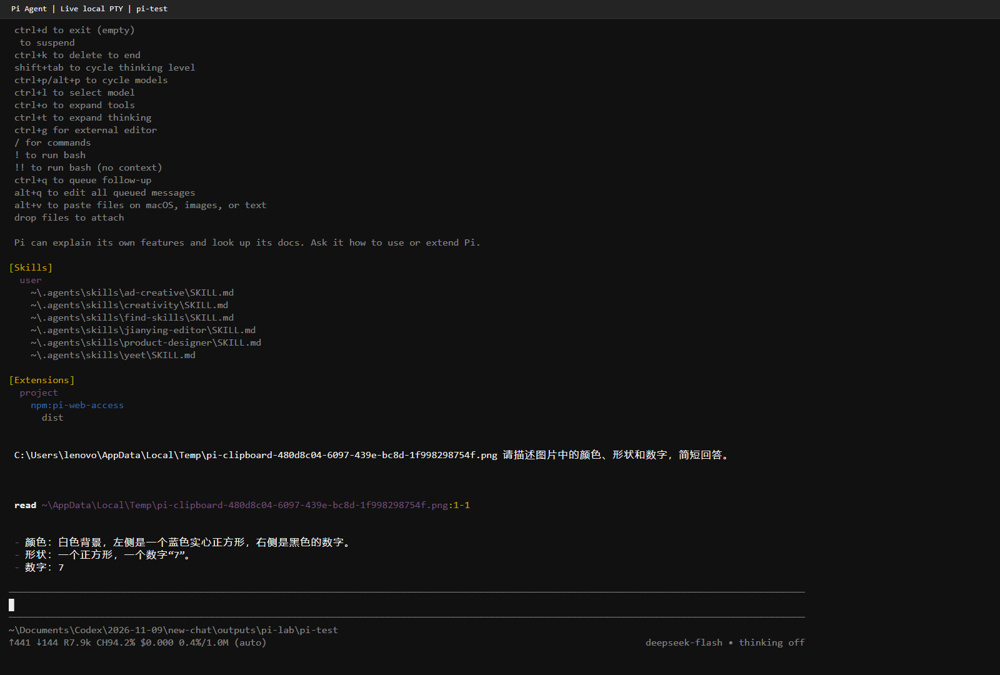

## 五 安装并使用插件

插件：`pi-web-access`。  
来源：[Pi Packages](https://pi.dev/packages/pi-web-access)、[npm](https://www.npmjs.com/package/pi-web-access)、[源仓库](https://github.com/nicobailon/pi-web-access)。  
实验安装版本：0.47.0。用途为网页搜索、URL 内容提取等。本次只测试公开网页抓取，不配置额外搜索服务。

在练习项目中执行项目级安装：

```powershell
pi install npm:pi-web-access -l --approve
```

退出旧 Pi 进程并重新启动，`[Extensions] project` 列出 `npm:pi-web-access`，证明资源已加载。

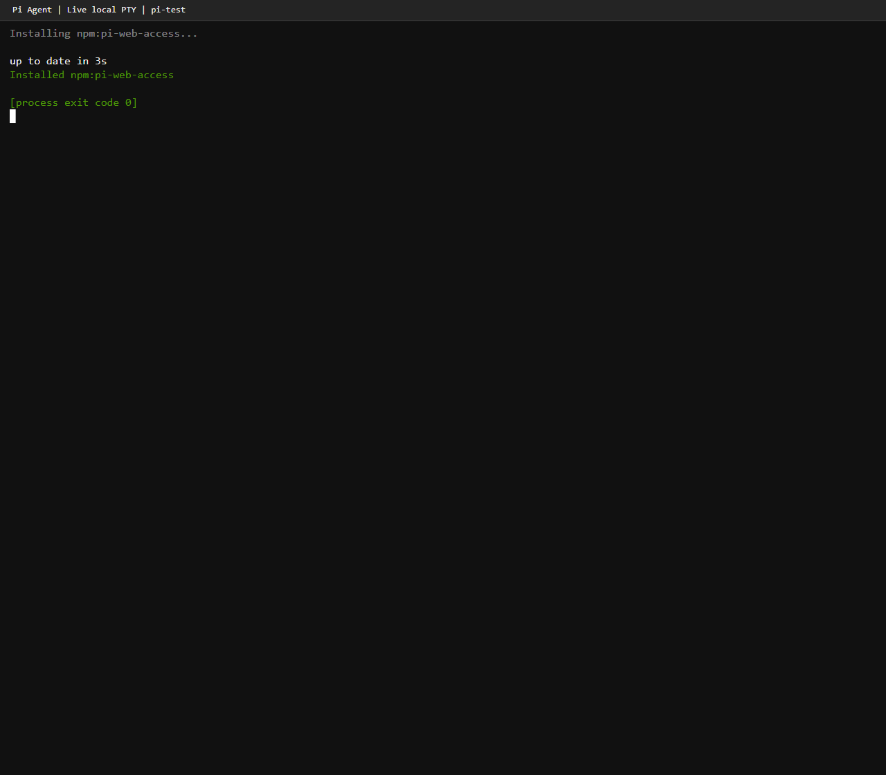


发送“请使用 pi-web-access 插件的 fetch_content 工具获取 https://example.com 的页面标题，只返回标题和来源，不要使用 bash 或其他工具。”

第一次普通抓取失败后，Pi 使用插件的 `raw` 模式重试成功，抓取结果包含 HTML 的 `<title>Example Domain</title>`，最后返回标题 `Example Domain` 和来源地址。加载成功和网页抓取成功分别由截图记录。

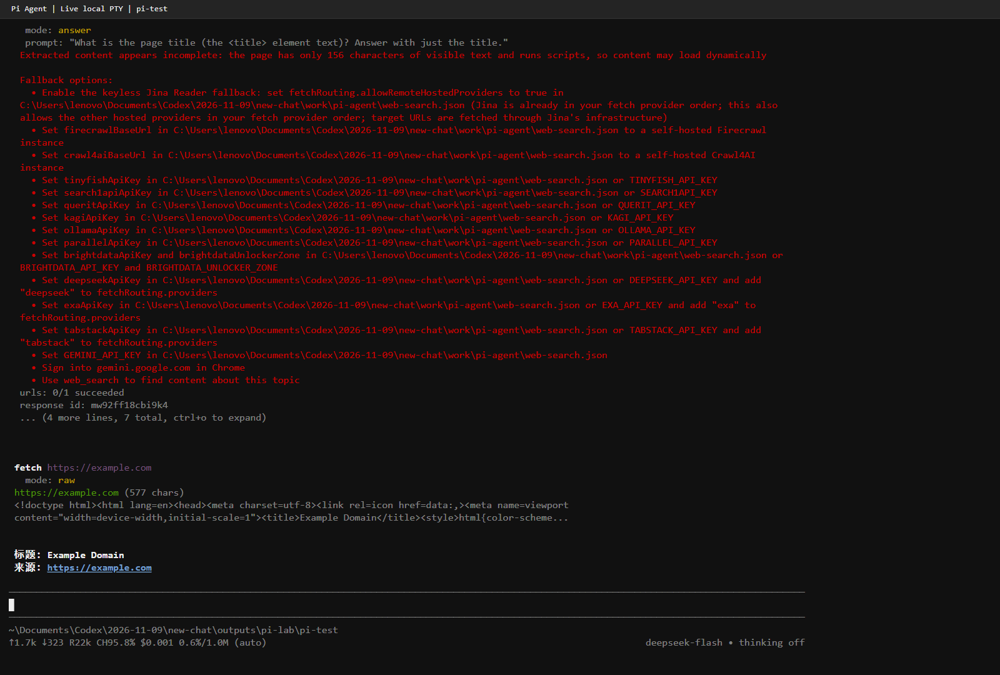

## 六 PPT Skill 安装与调用

在 Pi 中要求 AI 从 [anthropics/skills](https://github.com/anthropics/skills) 下载 `skills/pptx` 完整目录，安装到当前项目 `.pi/skills/pptx`，不自动安装依赖、不修改其他项目。

固定源 commit：`2c5958ecac7cee2b583967a2c4981d0f4a75c579`。

Pi 实际执行下载和按目录解压。核查结果为 56 个源文件，另有记录来源的 `SOURCE.txt`，共 57 个文件。用 GitHub tree 的 blob SHA 与本地 `git hash-object` 逐文件比较：56 个源文件、0 个不匹配。

```text
pi-test/
  .pi/
    skills/
      pptx/
        SKILL.md
        LICENSE.txt
        SOURCE.txt
        scripts/
          __init__.py
          add_slide.py
          clean.py
          thumbnail.py
          office/
            helpers/
            schemas/
            validators/
            ...
```

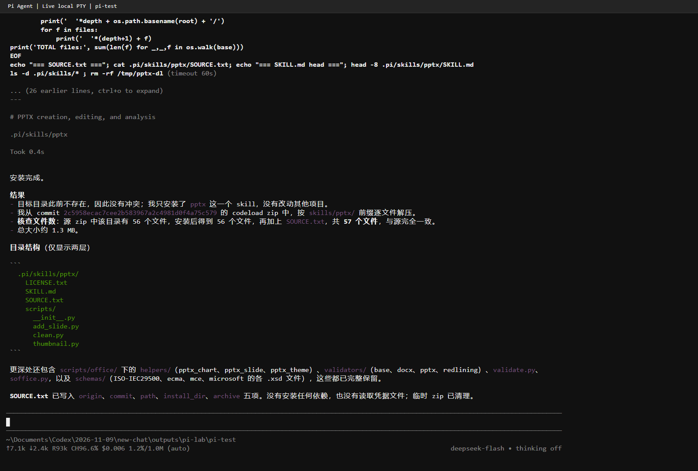

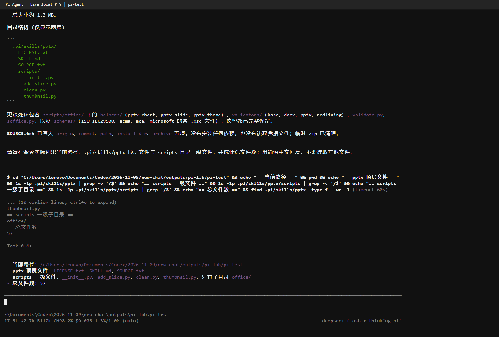

完全退出并重启 Pi 后，`[Skills] project` 显示当前项目 `.pi/skills/pptx/SKILL.md`。

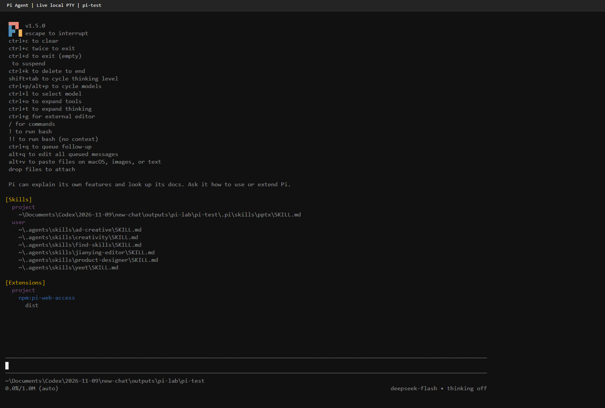

显式调用：

```text
/skill:pptx 请简短说明这个 Skill 的名称、用途和所在目录。本次只验证调用，不生成 PPT，不安装依赖，不修改文件。
```

界面显示 `[skill] pptx`，回复说明其用于 PowerPoint 文件的创建、编辑、读取和检查，路径指向本次项目安装目录。安装、发现和调用三个层次均已验证；没有声称完成 PPT 生成。

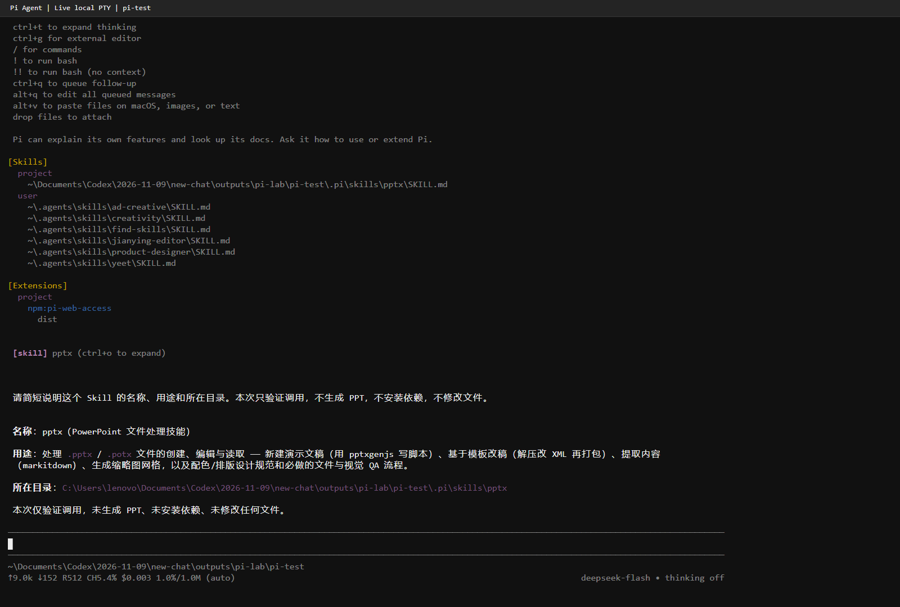

Skill 的许可证限制复制与再分发，因此第三方 Skill 源文件仅保留在本机，不随作业仓库分发。仓库保留来源、commit、哈希核验和验收截图。

## 七 截图与提交说明

所有最终截图统一位于 `screenshots/`。截图来自真实本机 Pi 进程的 PTY，由全屏终端网页显示，未伪造输出、改写模型回复或合成实验结果。截图只包含实验界面，不包含桌面、聊天窗口或其他应用。主要验收截图为 1600×1080，插件安装截图为 1280×1120。

仓库只保存报告、截图、原始小图片、hello.py 和不含密钥的复现配置。凭据、依赖、会话原始日志、被替代的排查截图、第三方受限源文件均不上传。

本次自动化协助完成了命令执行、截图整理和实验记录，报告中的操作及结果均经过实际工具验证。

## 参考资料

- [Pi 官方仓库与安装说明](https://github.com/earendil-works/pi)
- [Pi 模型配置说明](https://github.com/earendil-works/pi/blob/main/packages/coding-agent/docs/models.md)
- [Pi Packages](https://pi.dev/packages)
- [DeepSeek API 平台](https://platform.deepseek.com/api_keys)
- [pi-web-access](https://github.com/nicobailon/pi-web-access)
- [PPT Skill 固定版本](https://github.com/anthropics/skills/tree/2c5958ecac7cee2b583967a2c4981d0f4a75c579/skills/pptx)
